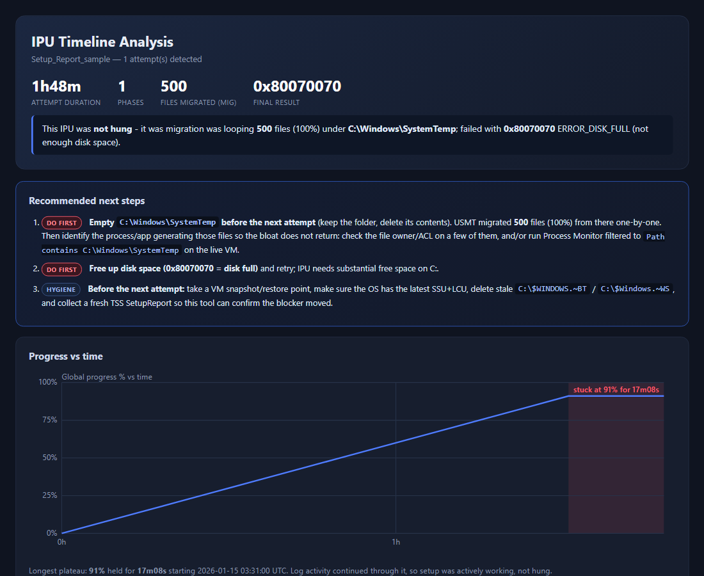

# ipu-timeline

**Find out why a Windows Server in-place upgrade (IPU) is stuck, slow, or failed — in
seconds, not hours of scrolling through `setupact.log`.**

`ipu_analyze.py` is a single, dependency-free Python script that reads Windows Setup's
own logs and renders a self-contained HTML report whose whole point is to answer one
question: **what is actually blocking this upgrade, and what should you try next?**

Built and validated against **Windows Server** in-place upgrades — 2012 R2/2016/2019 →
2016/2019/2022/2025, on-prem or on an [Azure VM](https://learn.microsoft.com/en-us/azure/virtual-machines/windows-in-place-upgrade).
See [Scope: Windows Server only (so far)](#scope-windows-server-only-so-far) below
before pointing this at a Windows 11/client upgrade.



## Two ways to run it

You don't need to collect logs first if you're already on the affected machine.

**1. Run it directly on the server having the problem — no log collection needed:**

```powershell
python ipu_analyze.py --local -o report.html
```

This reads straight from the well-known Windows Setup log locations
(`$WINDOWS.~BT\Sources\Panther`, `C:\Windows\Panther`, `C:\Windows\Logs\CBS`, etc.) —
no TSS, no log-gathering tool, no zip file. Run it as soon as possible after a
stuck/failed attempt: Windows deletes these logs automatically roughly 10 days after
the upgrade finishes or rolls back (sooner if someone runs Disk Cleanup's "Previous
Windows installation(s)"). You may need an elevated/Administrator prompt to read some
of them.

**2. Point it at logs you already collected** — from a TSS export, a tool like
[Microsoft's `TSS`](https://aka.ms/getTSS), a copied `Setup_Report` folder, or just a
`setupact.log` someone emailed you:

```powershell
python ipu_analyze.py path\to\TSS_Export.zip -o report.html
python ipu_analyze.py path\to\Setup_Report_folder -o report.html
python ipu_analyze.py path\to\setupact.log -o report.html
```

`INPUT` can be a `.zip` (only the needed logs are extracted), a `Setup_Report` folder,
a parent folder containing **multiple** `Setup_Report*` captures (produces a
comparison page across attempts), or a single `setupact.log`.

## Quickstart with a synthetic sample

No log to test with? Generate a small, fully made-up sample and render it:

```powershell
python samples\make_sample.py
python ipu_analyze.py samples\Setup_Report_sample -o samples\sample_report.html
```

(A ready-made copy is already committed at `samples/sample_report.html` — open it in a
browser to see what a report looks like.)

## What the report tells you

1. **Recommended next steps** — prioritized DO FIRST / NEXT / HYGIENE actions derived
   from the findings, not a generic checklist.
2. **Attempts overview** — one row per attempt (window, duration, max %, longest
   stall, top migrated folder). Attempts are split on `SetupHost Logging Begin`.
3. **Progress vs. time** — the global-progress % curve, extended flat through a stall
   so "stuck at NN%" reads as one continuous line instead of blank space.
4. **Hang vs. busy plateau** — a flat % is only called a **hang** when the log itself
   goes silent for 30+ minutes through it. Otherwise it's reported as *busy* (e.g.
   USMT still migrating files) with the longest-running operation called out.
5. **Phase durations & longest operations** — from `Setup phase change:` markers and
   the SP operation table, including a synthetic bar for an offline-apply/migration
   op that never completes when the run is cancelled mid-way.
6. **Finalize timing telemetry** — `CSetupDiagnostics … [*Time]=[0x..]` values (e.g.
   `DriverMigrationTime` dominating = USMT file migration is the bottleneck).
7. **Migrated-file hotspots** — `MIG … Processing File:` lines bucketed by folder.
   `C:\Windows\SystemTemp` dominating is the classic multi-hour cause: USMT looping
   millions of tiny temp files one at a time.
8. **USMT migration breakdown** (`--miglog`, opt-in — `MigLog.xml` can be 300 MB+) —
   migrated units by group/role/agent and migration-plugin action counts.
9. **Online/new-OS phase** — distinguishes an offline-applied specialize phase
   (labeled explicitly as *not* a real reboot) from a true post-reboot first boot.
10. **Outcome** — the final result code with a plain-English explanation, SetupDiag's
    failing operation, a **compatibility hard-block panel** (parsed from
    `ScanResult.xml` — e.g. a domain controller missing `ADPREP /DOMAINPREP`, with
    targeted remediation), a **migration-plugin Gather-failure callout** (the real
    blocker when a USMT plugin fails, instead of the generic wrapper error code that
    follows it), and an intentionally honest **CBS corruption assessment** (NOISE /
    RELEVANT / BLOCKER — it will not overstate corruption as *the* cause from logs
    alone).
11. **Which logs to check** — a short IPU log cheat-sheet.
12. **No-IPU / incomplete-capture detection** — if the logs show no in-place upgrade
    ever ran, or the capture was cut off mid-write (a long run of NUL padding at EOF),
    the report says so plainly instead of guessing or fabricating a final result.

## Supported inputs at a glance

| Input | What happens |
|---|---|
| `--local` | Reads the live machine's own Panther/CBS/BlueBox logs directly. |
| `some.zip` | A TSS export or any zip containing a `Setup_Report`-style layout; only the needed files are extracted to a temp dir and cleaned up afterward. |
| `Setup_Report_*\` folder | Analyzed directly. |
| folder with several `Setup_Report*` subfolders | Multi-capture comparison page + one detail page per capture, oldest → newest — useful for seeing whether a fix actually moved the needle across retries. |
| a bare `setupact.log` | Analyzed on its own (looks for a sibling `setuperr.log` too). |

## CLI reference

```
python ipu_analyze.py <INPUT> -o <OUT.html> [--json <MODEL.json>] [--attempt N] [--all] [--miglog]
python ipu_analyze.py --local [-o <OUT.html>] [--json <MODEL.json>] [--miglog]
```

| Flag | Meaning |
|---|---|
| `INPUT` | TSS `.zip` / `Setup_Report` folder / parent folder with multiple captures / `setupact.log`. Omit when using `--local`. |
| `--local` | Analyze this machine directly instead of a collected log/export. |
| `-o, --out` | Output HTML path (default `ipu_report.html`). |
| `--json` | Also write the parsed model as JSON. |
| `--attempt N` | Detail this attempt (1-based); default is the last attempt. |
| `--all` | Render detail for every attempt instead of just one. |
| `--miglog` | Also parse `MigLog.xml` for a USMT migration breakdown (off by default — can be 300 MB+). |

Requires **Python 3.7+**, standard library only — nothing to `pip install`. Streams
very large logs (150 MB+ `setupact.log`) in a single pass.

## Scope: Windows Server only (so far)

This tool was built and tested entirely against **Windows Server** in-place upgrades
(2012 R2/2016/2019 → 2016/2019/2022/2025), following the official process described in:

- [Upgrade Windows Server in place](https://learn.microsoft.com/en-us/windows-server/get-started/upgrade-in-place?tabs=media) (installation media or Windows Update)
- [Windows in-place upgrade - Azure Virtual Machines](https://learn.microsoft.com/en-us/azure/virtual-machines/windows-in-place-upgrade) (Azure VM-specific guidance; also notes the caveats around Azure guest-patching/image features after an in-place upgrade)

**Windows 11/client in-place upgrades (feature updates) are untested.** Client Windows
uses the same underlying Setup/Panther logging family, so some of this *may* carry
over, but the phase names, folder layout, and result/extend codes have not been
verified against real client-upgrade logs, and this repo has no client sample data. If
you try it against a Windows 11 feature-update capture, treat the output with caution
— and a PR with a validated client sample/fixture is very welcome.

## Known limitations

- `--local` only finds anything while the upgrade's working folders still exist —
  Windows removes `$WINDOWS.~BT` automatically (roughly 10 days after the upgrade
  finishes/rolls back, sooner via Disk Cleanup), so run it promptly after a
  stuck/failed attempt, or fall back to a saved TSS export.
- The CBS corruption verdict is intentionally conservative: it will call corruption
  "relevant" rather than claim it's definitively *the* blocker unless the failure
  itself is a servicing/store error.
- Truncated-capture detection is a NUL-byte-tail heuristic; a log that happens to end
  exactly on a sector boundary with legitimate trailing NULs could in theory
  false-positive (not observed in practice).
- Not validated against Windows 11/client in-place upgrades — see
  [Scope](#scope-windows-server-only-so-far) above.

## Contributing

Issues and PRs welcome — especially new result-code meanings (`CODE_MEANINGS`), new
migrated-path buckets (`classify_path`), or new `ScanResult.xml` hard-block plugin
guidance (`SCAN_BLOCK_GUIDANCE`) in `ipu_analyze.py`.

## License

[MIT](LICENSE)
